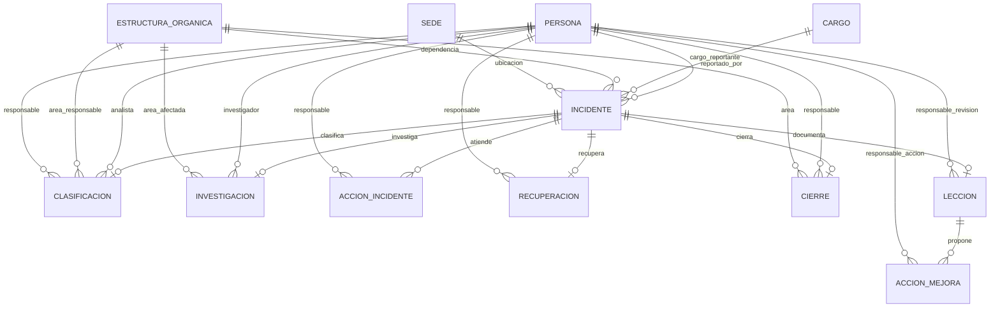

# Esquema lógico preliminar de incidentes

**Estado:** borrador para revisión del equipo. No es una migración ni autoriza
la implementación.

## Alcance

El esquema cubre las etapas con captura de datos de F-GTI-01 a F-GTI-07.
F-GTI-08 (bitácora) y F-GTI-09 (reporte a Dirección) se consideran consultas
derivadas, no entidades de captura en este borrador. Los modelos institucionales
se representan como referencias externas; no se propone crear sus tablas en
ACU1.

La fuente de los campos son `UNISARC_Formularios_Ciberseguridad.xlsx`,
`04_Formularios_FGTI_ACTUALIZADOS.docx` y
`01_Plan_Ciberseguridad_15_Dias_ACTUALIZADO.docx`.

## Diagrama entidad-relación

`PERSONA`, `CARGO`, `SEDE` y `ESTRUCTURA_ORGANICA` son referencias
institucionales conceptuales. Sus nombres de aplicación Django y modelos
reales aún deben verificarse en el repositorio completo de SAIUNISARC.

## Relaciones, PK/FK y cardinalidades propuestas

| Entidad | PK propuesta | Relación/FK | Cardinalidad propuesta | Observación |
|---|---|---|---|---|
| Incidente | `id` | `no_incidente` único | — | El código visible del formulario no reemplaza la PK. |
| Incidente | — | `reportado_por` → Persona | Persona 1 : N incidentes | El origen de la identidad de sesión y su enlace a Persona están pendientes de verificación. |
| Incidente | — | `cargo` → Cargo | Cargo 1 : N incidentes | Debe corresponder a una asignación válida del reportante; la regla de selección está pendiente. |
| Incidente | — | `dependencia` → EstructuraOrganica | Dependencia 1 : N incidentes | F-GTI-01 la deriva del cargo; se debe decidir si guardar una instantánea o consultar el cargo. |
| Incidente | — | `ubicacion` → Sede | Sede 1 : N incidentes | El detalle del lugar dentro de la sede sería texto adicional. |
| Clasificacion | `id` | `incidente` → Incidente (OneToOne) | Incidente 1 : 0..1 clasificación | Suponer una sola clasificación impide conservar reclasificaciones como historial. |
| Clasificacion | — | `analista`, `responsable` → Persona | Persona 1 : N asignaciones | Son roles distintos en F-GTI-02. |
| Clasificacion | — | `area_responsable` → EstructuraOrganica | Área 1 : N clasificaciones | Puede diferir de la dependencia que reporta. |
| Investigacion | `id` | `incidente` → Incidente (OneToOne) | Incidente 1 : 0..1 investigación | Debe confirmarse si se requiere más de una investigación o revisiones históricas. |
| Investigacion | — | `investigador` → Persona | Persona 1 : N investigaciones | Reutilizar el catálogo institucional una vez ubicado. |
| Investigacion | — | `area_afectada` → EstructuraOrganica | Área 1 : N investigaciones | Campo nuevo de F-GTI-03; no equivale a Dependencia de F-GTI-01 ni a Área Responsable de F-GTI-02. |
| AccionIncidente | `id` | `incidente` → Incidente (FK) | Incidente 1 : N acciones | Permite conservar varias acciones F-GTI-04 sin sobrescribirlas. |
| AccionIncidente | — | `responsable` → Persona | Persona 1 : N acciones | Estado pertenece a cada acción, no al incidente. |
| Recuperacion | `id` | `incidente` → Incidente (OneToOne provisional) | Incidente 1 : 0..1 recuperación | Confirmar si un incidente puede recuperar varios servicios o tener varias recuperaciones. |
| Recuperacion | — | `responsable` → Persona | Persona 1 : N recuperaciones | La fecha fin puede permanecer vacía mientras continúa la recuperación. |
| Cierre | `id` | `incidente` → Incidente (OneToOne) | Incidente 1 : 0..1 cierre | Confirmar reapertura, cierres sucesivos y retención del historial. |
| Cierre | — | `responsable` → Persona | Persona 1 : N cierres | La autorización para cerrar es una regla de permiso, no un rol confirmado por el modelo. |
| Cierre | — | `area` → EstructuraOrganica | Área 1 : N cierres | No asumir que es la misma que reporta o atiende. |
| Leccion | `id` | `incidente` → Incidente (OneToOne provisional) | Incidente 1 : 0..1 lección | Confirmar si se registra una sola revisión de lecciones por caso. |
| Leccion | — | `responsable` → Persona | Persona 1 : N lecciones | Representa a quien registra/revisa lo aprendido. |
| AccionMejora | `id` | `leccion` → Leccion (FK) | Lección 1 : N acciones | Cada mejora tiene responsable, fechas y estado propios. Su incidente se obtiene por la lección, evitando una FK redundante que pudiera apuntar a otro caso. |
| AccionMejora | — | `responsable_accion` → Persona | Persona 1 : N mejoras | Distinto del responsable de redactar la lección. |

Todas las etapas F-GTI-02 a F-GTI-07 quedan vinculadas al mismo incidente,
directamente mediante su FK o, en el caso de `AccionMejora`, por la relación con
`Leccion`.

## Datos derivados, no duplicados

- F-GTI-03 `Criticidad` se consulta desde F-GTI-02; no se propone guardar otra
  copia que pueda divergir.
- F-GTI-06 `Usuarios Afectados` se consulta desde F-GTI-02 por la misma razón.
- F-GTI-08 se construye consultando F-GTI-01, F-GTI-02, F-GTI-03 y F-GTI-06.
  Su `Area Afectada` proviene de la investigación.
- Los conteos de F-GTI-09 se calculan sobre incidentes y su criticidad. Los
  indicadores sin una fuente medible deben mostrarse como «Sin datos».

## Decisiones de cardinalidad para aprobar

1. Si F-GTI-02 puede reclasificarse más de una vez y cómo conservar el historial.
2. Si F-GTI-03 admite varias investigaciones por incidente.
3. Si F-GTI-05 es una etapa única o una recuperación por servicio afectado.
4. Si F-GTI-06 permite reaperturas y cierres sucesivos.
5. Si F-GTI-07 es una sola lección por caso o varias revisiones.
6. Si F-GTI-01 y F-GTI-03 permiten uno o varios archivos de evidencia.
